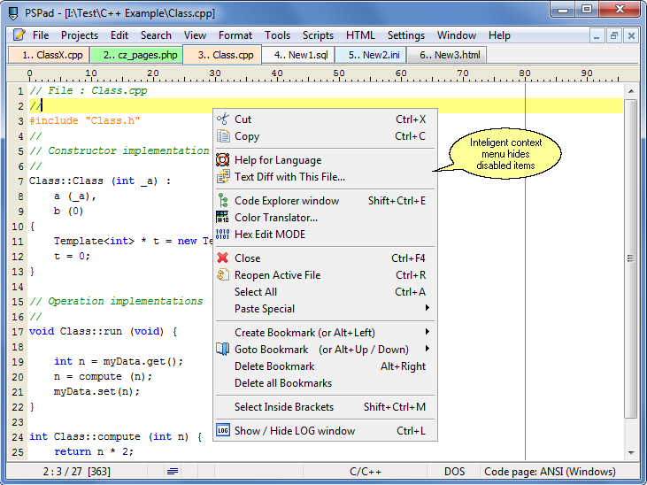
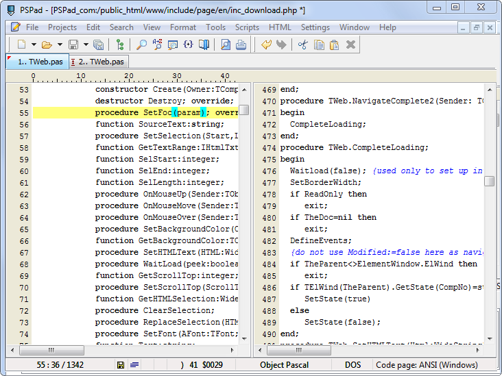

# PSPad for Text Editing and Source Review

PSPad is a freeware text and source-code editor for Microsoft Windows.
It combines syntax-aware editing with projects, search tools, file comparison, and other developer utilities.

This independent PSPad IDE guide focuses on repeatable editing and file review.
PSPad can be used for plain text as well as work across several programming languages.

[](https://pspad-ide.github.io/PSPad/)

The supplied source snapshot belongs to Geany, a separate open-source editor and lightweight IDE.
Its linked files provide comparative references for editor extensions and maintenance tooling.
They are not PSPad source code, PSPad plug-ins, or PSPad configuration files.

## About

A PSPad code editor workflow benefits from clear file boundaries and deliberate save settings.
Record the language, expected encoding, and line-ending convention when exchanging source files.

A PSPad text editor task may involve logs, configuration, documentation, or structured data.
Choose the editing tools according to the file's contents rather than its extension alone.

PSPad portable packages are offered on the [official download page](https://www.pspad.com/en/download.php).
Preserve their directory structure and check release-specific instructions when moving a working environment.

- Keep a recoverable copy before a large replacement.
- Confirm which document is active before applying an operation.
- Review the changed text before saving over a shared file.
- Distinguish an editor session from a backup of its documents.

## Features

| Editing task | Practical approach | Review before saving |
| --- | --- | --- |
| Source editing | Select the appropriate syntax profile | Check comments, strings, and indentation |
| Search and replace | Start with a narrow scope and inspect matches | Confirm the intended files and replacement count |
| File comparison | Compare versions representing the same stage | Separate content changes from whitespace changes |
| Encoding work | Identify the expected character encoding | Reopen the result and inspect non-ASCII characters |
| Project navigation | Group related files and use recognizable names | Confirm that referenced files still exist |
| Repeated edits | Test a macro or operation on a small example | Check the result before applying it more broadly |

Syntax highlighting helps navigation but does not establish that a program is valid.
Use the relevant language tools when checking syntax or runtime behavior.

For a long document, compare a local section with its surrounding context.
A change that appears correct in isolation can still alter a nearby block or repeated structure.



The supplied Geany extension references include:

- [splitwindow.c](plugins/splitwindow.c), which provides a split editor view.
- [saveactions.c](plugins/saveactions.c), which implements save-related actions.
- [filebrowser.c](plugins/filebrowser.c), which provides file browsing.
- [htmlchars.c](plugins/htmlchars.c), which handles HTML character helpers.

Those files illustrate how another editor organizes optional behavior.
They do not define PSPad commands, save settings, or extension installation steps.

## Usage

For a replacement task, decide whether the search expression is literal or regular-expression based.
Test on a small sample that contains both intended matches and similar text that should remain unchanged.

An independent text search can help verify the scope before editing.
This PowerShell example searches existing UTF-8 files for a literal marker.

```powershell
$inputFiles = @("notes.txt", "settings.ini")
$searchMarker = "TODO:"
Select-String -LiteralPath $inputFiles -Pattern $searchMarker -SimpleMatch -Encoding UTF8
```

The example assumes the named files already exist.
It displays matches without changing them or launching PSPad.

Microsoft documents the command in the [Select-String reference](https://learn.microsoft.com/en-us/powershell/module/microsoft.powershell.utility/select-string).
The example uses literal matching; regular-expression behavior must be considered separately.

- Compare the search scope with the intended document set.
- Check case sensitivity when identifiers differ only by case.
- Review matches in comments and strings.
- Inspect the first and last changed sections after a replacement.

For project navigation, an editor's symbol information can help locate definitions.
Generated symbol data can become stale when the underlying code changes.

The supplied Geany symbol-tooling references are:

- [create_py_tags.py](scripts/create_py_tags.py), which generates Python symbol data.
- [create_php_tags.py](scripts/create_php_tags.py), which generates PHP symbol data.
- [print-tags.py](scripts/print-tags.py), which displays tag information.
- [update-ctags.py](scripts/update-ctags.py), which updates parser sources.

These tools belong to Geany's development workflow.
They are not PSPad code-explorer configuration or a PSPad indexing API.

## Translations

Interface language, file encoding, and the language of the document are different concerns.
Changing a menu language does not by itself convert the document's bytes.

The following Python example inspects an existing file without rewriting it.
It checks whether the bytes decode as UTF-8 and reports common line-ending patterns.

```python
from pathlib import Path
raw = Path("sample.txt").read_bytes()
text = raw.decode("utf-8-sig")
print("Characters:", len(text))
print("CRLF endings:", raw.count(b"\r\n"))
print("Standalone LF:", raw.count(b"\n") - raw.count(b"\r\n"))
print("Standalone CR:", raw.count(b"\r") - raw.count(b"\r\n"))
```

The example assumes Python is available and sample.txt exists.
A decoding error means the bytes are not valid under that UTF-8 interpretation.

Successful decoding does not prove that UTF-8 was the author's intended encoding.
The example also reads the entire file into memory, so use a manageable sample.

Python's [pathlib documentation](https://docs.python.org/3/library/pathlib.html) describes reading file bytes.
After an encoding change, reopen the saved file and check characters that reveal conversion problems.

The supplied [update-year-in-po.sh](scripts/update-year-in-po.sh) maintains Geany translation-file metadata.
It is not a PSPad language pack or an encoding conversion tool.



## Development

An editor extension must target the application and interface for which it was written.
Do not infer compatibility from similar menu labels or feature names.

The supplied Geany plug-in development references are:

- [geanyplugin.h](plugins/geanyplugin.h), which collects public plug-in headers.
- [geanyfunctions.h](plugins/geanyfunctions.h), which provides a compatibility header.
- [demoplugin.c](plugins/demoplugin.c), which demonstrates a Geany plug-in.
- [classbuilder.c](plugins/classbuilder.c), which creates source files for class types.
- [export.c](plugins/export.c), which exports the current document to other formats.

These resources are specific to Geany.
They should not be built or distributed as PSPad extensions.

Two additional maintenance references are:

- [update-themes.py](scripts/update-themes.py), which updates Geany theme resources.
- [update-python-identifiers.sh](scripts/update-python-identifiers.sh), which refreshes Python identifier lists.

Their target files and assumptions belong to Geany's source layout.
They do not establish which themes or language definitions PSPad can load.

For editor automation, record the exact PSPad version and architecture.
Confirm the relevant scripting or command interface in release-specific documentation before using it.

## Ideas, questions, patches and bug reports

A useful issue report explains the smallest edit that produces the unexpected result.
Include the input text, the operation, and the resulting text when possible.

- Identify the PSPad version and whether it is an installed or portable package.
- State the active syntax profile.
- Record encoding and line endings when they affect the issue.
- Include the search expression and relevant options for replacement problems.
- Explain whether the issue occurs in a new document.
- Remove credentials and private content from examples.

For a display issue, distinguish the visible rendering from the bytes saved on disk.
For a save issue, compare the reopened file with the expected result.

The [official PSPad site](https://www.pspad.com/en/) links product information and support resources.
Use the [PSPad forum](https://forum.pspad.com/) for version-specific questions and reproducible reports.

## Related Search Terms

PSPad IDE, PSPad, PSPad code editor, PSPad text editor, PSPad portable, text-editor, editor, ide, syntax-highlighting, code-editor, windows, programming, unicode, regular-expressions, portable
